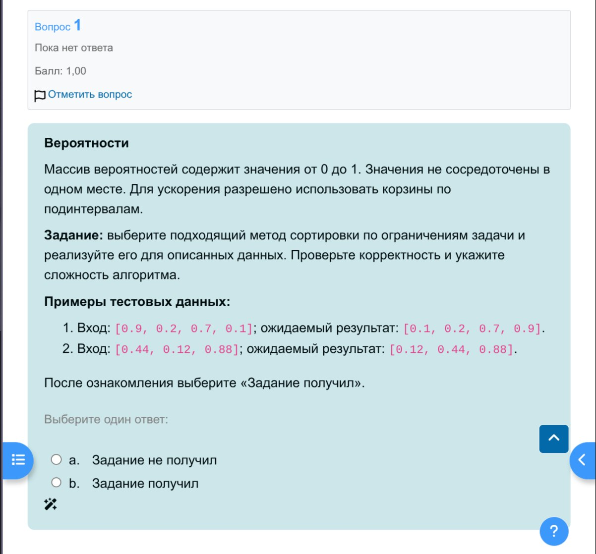
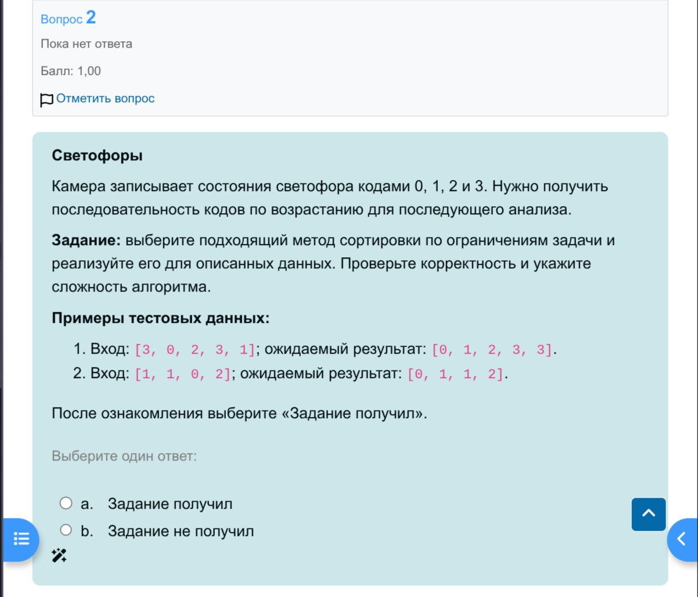
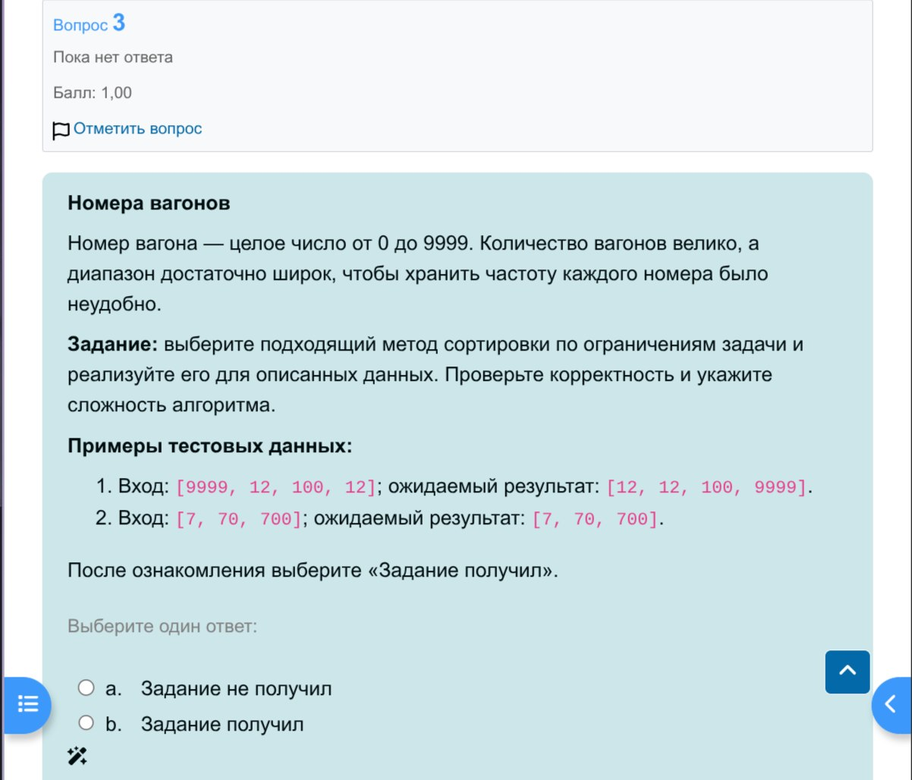

# Алгоритмы и анализ сложности Лабораторная работа №2

## Скачать одну папку

```bash
git clone --filter=blob:none --no-checkout https://github.com/axstiz/Java-learning.git
cd Java-learning
git sparse-checkout init --no-cone
git sparse-checkout set 'labs/algorithms/lab-02-algs'
git checkout main
```

## Задания

### First.java



### Second.java



### Third.java




## Выполнил

Вахрушев Матвей Евгеньевич, РИ-250912
